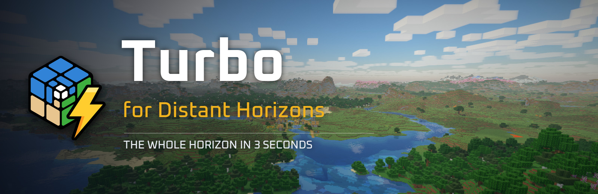
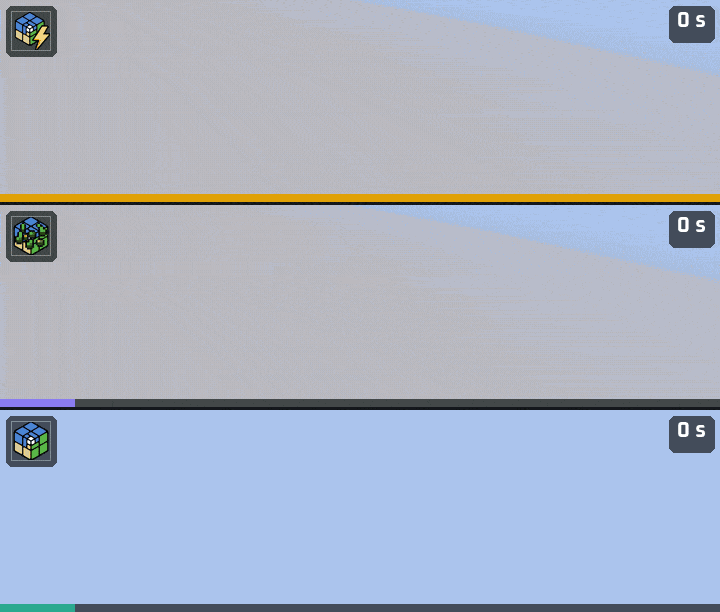
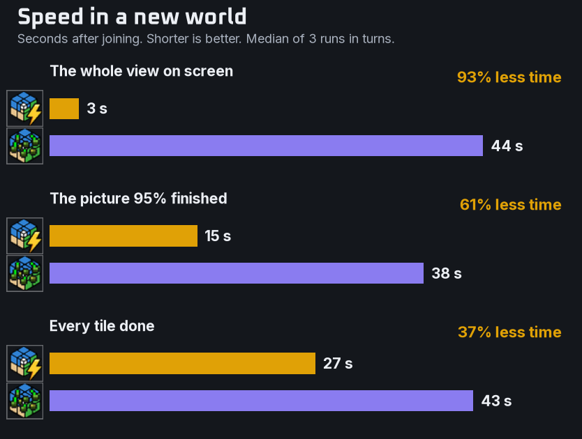
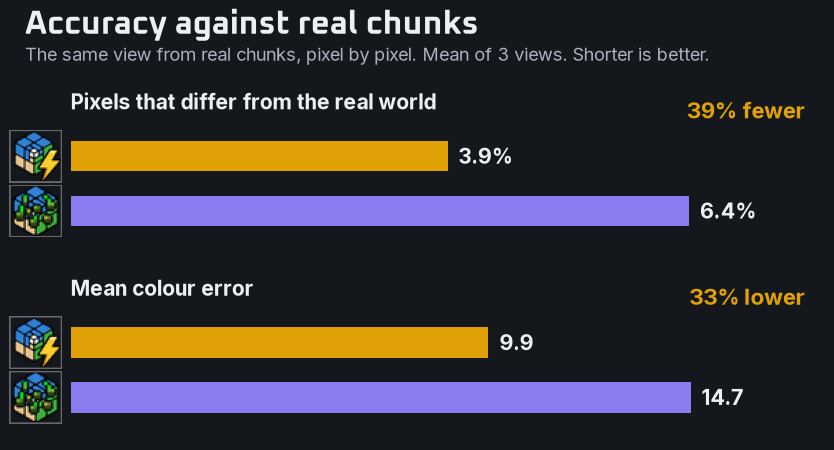
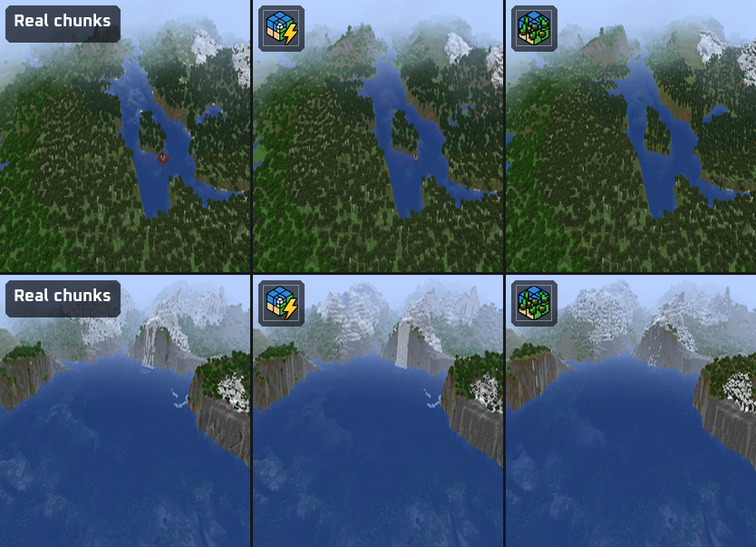
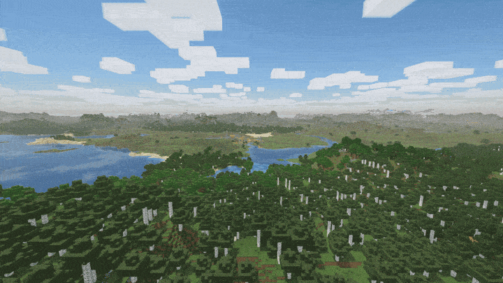
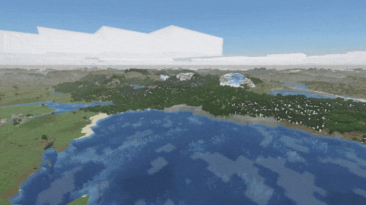
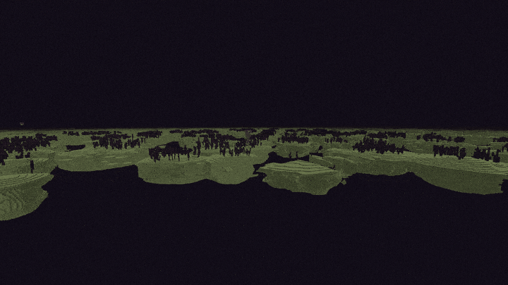

<!-- CurseForge description of Turbo for Distant Horizons. HTML: paste it in the editor's HTML (source) mode, not Markdown mode.
     The "more-mods" block is generated by tools/mod-catalog/sync_mod_links.py - never edit it by hand. -->

   

<em>A generator for Distant Horizons that builds distant terrain straight from the world's noise, without generating a single chunk.</em>

<strong>Join a new world and the whole horizon is there about 3 seconds later. It starts coarse and sharpens pass by pass, beginning with what you look at. Surface, trees and structures come from the game's own rules and seeds, so the distance matches the world you will walk into.</strong>

<em>Same seed, same camera, clock running from the moment of joining, shown at 3x speed. Top: this mod. Middle: another seed-based generator for Distant Horizons. Bottom: Distant Horizons alone.</em>

<strong>93%</strong> less time to the whole view &nbsp;&middot;&nbsp; <strong>61%</strong> less time to a finished picture &nbsp;&middot;&nbsp; <strong>39%</strong> fewer pixels off the real world

<h2 style="text-align:center">Speed, measured</h2>

<em>A fresh world for every run, the generators in turns, nothing else running. "Finished" means a pixel has reached the colour it ends up with. The frame rate stayed within one FPS of the other generator (58 and 59 under a limit of 60).</em>

<h2 style="text-align:center">Closer to the real world</h2>

<em>Distant Horizons fed by real chunks gives the reference picture. Each finished frame is compared with it pixel by pixel. Land heights match real chunks on 94 to 98% of columns at every distance, and biomes on 99.5%.</em>

<h2 style="text-align:center">Why the horizon comes first</h2>

A tile has 64 x 64 columns whether a column is 1 block wide or 32, so it costs about the same at every detail level. The coarsest tiles buy the most land: about 25 of them cover a view 8 km across. The mod asks Distant Horizons for those first, then lowers the wish one level per pass. Each pass halves the column width everywhere at once, and tiles are ordered from a point ahead of you. A section replaces its parent when all four are ready, so the view stays whole while it sharpens.

<h2 style="text-align:center">Noise instead of chunks</h2>

The world's density function is rewritten so its 2D parts run once per column, and caves are left out of the height search. Heights are read on the game's own cell corners, which takes 2 or 3 probes per column. That is how a far tile stays as cheap as a near one. Tiles run on their own worker threads, and each one stays in its own section, so Distant Horizons rebuilds far less per tile.

<h2 style="text-align:center">The game's own world</h2>

<em>Structures start from the game's seeds and stand where the game will build them. In a comparison with real generation every one was found at its real place. The world's surface rules cover the ground, also those of data packs. Trees and plants are the game's own features, replayed up to 4-block columns.</em>

<h2 style="text-align:center">Exact terrain near you</h2>

<em>While the generator is idle, the chunks just past your render distance are redrawn by the game's real generator, with caves, ores on cliffs and lakes. In test runs 92 to 95% of columns then matched the real world. Chunks your world has saved, like builds and adventure maps, reach Distant Horizons as they are.</em>

<h2 style="text-align:center">The Nether and the End</h2>

<em>Floating islands, chorus and end cities in the End. Caverns, the lava sea and fortresses under the bedrock roof of the Nether.</em>

<h3 style="text-align:center">Getting started</h3>

Put the mod next to <a href="https://www.curseforge.com/minecraft/mc-mods/distant-horizons">Distant Horizons</a> 3.3 (3.3.3 or a later 3.3) on Minecraft 1.20.1, 1.21.1, 1.21.11, 26.1.2, 26.2 or 26.3, with <a href="https://neoforged.net">NeoForge</a> or <a href="https://fabricmc.net">Fabric</a>, or <a href="https://files.minecraftforge.net">Forge</a> on 1.20.1. Fabric also needs <a href="https://www.curseforge.com/minecraft/mc-mods/fabric-api">Fabric API</a> and <a href="https://www.curseforge.com/minecraft/mc-mods/forge-config-api-port">Forge Config API Port</a>. There is nothing to set up. The mod is free and open source under the <a href="https://github.com/Pocky-l/dhturbo">MIT license</a>. In multiplayer a server without Distant Horizons shares the seed, so players generate the distance themselves. A server with it sends its own distant terrain and keeps the seed. Settings are under <em>Mods &gt; Turbo for Distant Horizons &gt; Config</em>, and <code>/dhturbo regenerate</code> redraws the distance of a world, for example after an update.

<h3 style="text-align:center">Good to know</h3>

The horizon comes first in singleplayer, and its first seconds are coarse: columns 32 blocks wide. Terrain already drawn keeps its look until you run <code>/dhturbo regenerate</code>. Beyond <code>exact_radius</code> caves and underground structures are not drawn. A world whose terrain the mod cannot read, for example from a mod with its own chunk generator, is left to Distant Horizons, and whoever runs the world is told in chat.

<strong>Works with</strong>

  

<!-- more-mods:start icons -->

<b>More mods by Pocky</b>

<!-- more-mods:end -->

Speed: i5-12400F, 6 cores, Minecraft 1.21.1, Distant Horizons 3.3.3 with 6 threads and a LOD radius of 256 chunks, one seed, medians of 3 runs, all three measured on 2026-11-07 against the newest version of the other generator. The first frames count from 3 seconds, when the camera is in place. Accuracy: 3 views on 2 seeds, LOD radius 64 chunks. Your numbers will differ with your PC and world. How the mod works and how to check its accuracy yourself: <a href="https://github.com/Pocky-l/dhturbo/blob/main/docs/how-it-works.md">how it works</a>.

Made by <strong>Pocky</strong>. Built on the Distant Horizons API by James Seibel and the Distant Horizons team, the logo is the Distant Horizons icon with a lightning bolt. Not affiliated with the Distant Horizons team. The other generator is shown with a stand-in icon.

